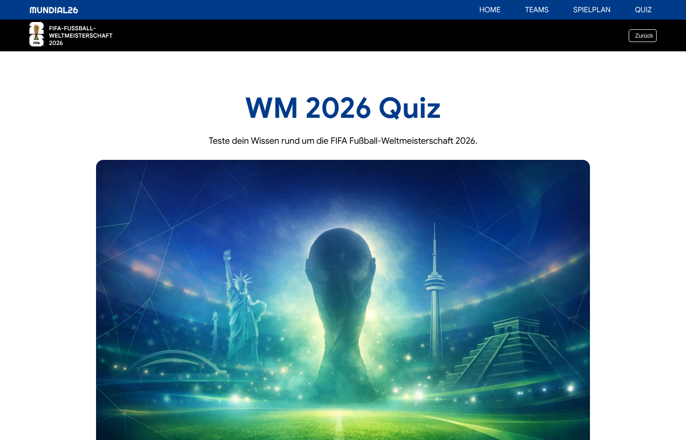
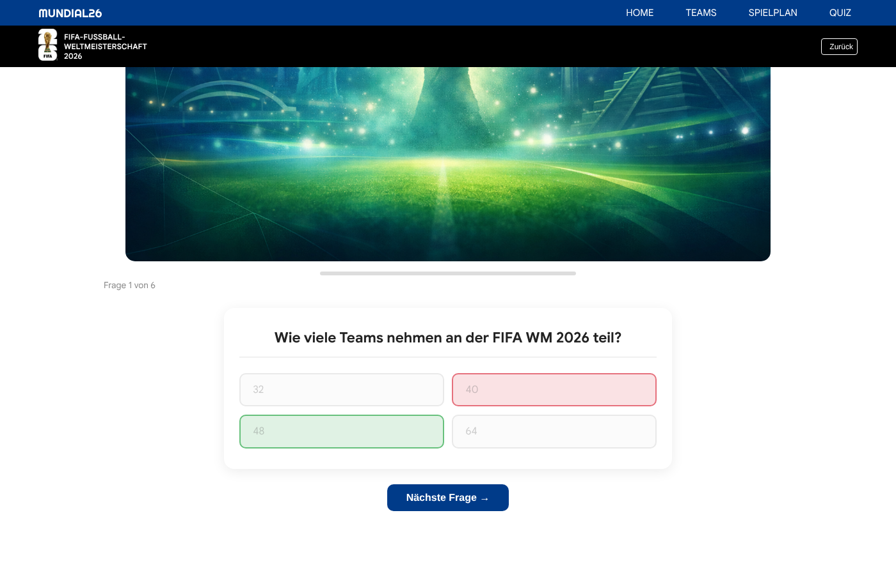

# Mundial26 – Informationsseite zur FIFA-WM 2026

Eine responsive Webseite rund um die FIFA Fußball-Weltmeisterschaft 2026 in den USA, Kanada und Mexiko. Sie bietet eine Startseite mit den wichtigsten Fakten, eine durchsuchbare Übersicht aller 48 Teams, den Spielplan und ein Quiz.

> **Kontext:** Webprojekt im Zweierteam, Hochschule Worms, Sommersemester 2026.



## Ziel

Das Projekt zeigt die Grundlagen moderner Webentwicklung ohne Framework:

- **Semantisches HTML5** mit mehreren verlinkten Seiten
- **Responsives Layout** mit CSS Grid und Flexbox nach dem Mobile-First-Prinzip
- **JavaScript** für Navigation, Filter und Quiz über DOM-Manipulation und Event Handling
- **SEO-Grundlagen** mit Meta-Tags, Open Graph und `sitemap.xml`
- **Teamarbeit mit Git** über Branches und Pull Requests

## Seiten

| Seite | Inhalt |
|---|---|
| `index.html` | Startseite: Hero-Bereich, Infokarten zu Spielplan, 48 Teams und Stadien (mit Video), Vorstellung der drei Gastgeberländer, Einstieg ins Quiz |
| `teams.html` | Alle 48 Teams als Karten mit Flagge, Gruppe und Konföderation; Suche nach Name und Filter nach Gruppe A bis L; Tabellenstand und Turnierbaum |
| `spielplan.html` | Spielplan mit allen Spielen, Spielorten und Anstoßzeiten |
| `quiz.html` | Quiz mit sechs Fragen, Fortschrittsbalken, Zähler, direkter Rückmeldung (richtig grün, falsch rot) und Ergebnis am Ende |



*Nach einer Antwort zeigt das Quiz sofort die richtige Lösung an.*

## Funktionen

| Bereich | Umsetzung |
|---|---|
| Navigation | Burger-Menü auf kleinen Bildschirmen, das sich beim Klick auf einen Link schließt; Zurück-Button über `history.back()` |
| Team-Suche | Die Teams liegen als Array von Objekten in `script.js`. Suche und Gruppenfilter wirken gleichzeitig und aktualisieren die Karten sofort. |
| Quiz | Fragen, Antworten und Lösungen liegen als Array in `script.js`. Punktestand und Fortschritt werden mitgezählt. |
| Responsive | Mobile-First mit Breakpoints bei 600, 792, 992 und 1200 px |
| SEO | `description`, Open-Graph-Tags, Favicons in mehreren Größen, `sitemap.xml` |

Mein Anteil am Projekt waren die Startseite und die Teams-Seite mit der Suchfunktion in JavaScript.

## Projekt starten

Es wird nur ein Browser benötigt, keine Installation und kein Build-Schritt.

- **Variante 1:** `index.html` per Doppelklick im Browser öffnen.
- **Variante 2:** In Visual Studio Code mit der Erweiterung *Live Server* öffnen.
- **Variante 3:** Einen lokalen Webserver starten und **http://localhost:8000** öffnen:

```bash
python -m http.server 8000
```

Für Schriften, Icons, Flaggen, Fotos und die eingebundenen Widgets wird eine Internetverbindung benötigt.

## Externe Inhalte

Nicht alle Inhalte sind selbst programmiert. Eingebunden werden:

| Inhalt | Quelle |
|---|---|
| Flaggen der Teams | [flagcdn.com](https://flagcdn.com) |
| Anstoßzeiten (Spielplan) | Widget von [anstosszeiten.de](https://anstosszeiten.de) |
| Tabellenstand und Turnierbaum | [world-cup-2026-readme-widget](https://github.com/moose25/world-cup-2026-readme-widget) |
| Icons | [Font Awesome 7](https://fontawesome.com) über CDN |
| Schriften | Michroma, Poppins, Righteous und Google Sans über Google Fonts |
| Illustrationen in Quiz und Spielplan | mit Microsoft Copilot erstellt |
| Fotos und Video der Startseite | extern verlinkt, Rechte bei den jeweiligen Urhebern |

## Dateistruktur

```
Webprojektss2026_mundial26/
├── index.html       # Startseite
├── teams.html       # Teams mit Suche und Filter
├── spielplan.html   # Spielplan
├── quiz.html        # WM-Quiz
├── style.css        # Gemeinsames Stylesheet für alle Seiten
├── script.js        # Navigation, Teamdaten und Filter, Quizdaten und Quizlogik
├── sitemap.xml      # Sitemap für Suchmaschinen
├── images/          # Logos, Favicons, Illustrationen, Open-Graph-Bild
├── docs/
│   ├── screenshot.png
│   └── quiz.png
└── README.md
```

## Technik

- **HTML5**
- **CSS3** (Grid, Flexbox, Media Queries, Mobile-First)
- **JavaScript** (DOM-Manipulation, Event Handling, Array-Methoden `filter` und `map`)
- **Git und GitHub** (Branches, Pull Requests)

## Team

- **Josias Ketcha**
- **Lars Gußmann**

Hochschule Worms, Sommersemester 2026

---

*Inoffizielles Studienprojekt ohne Verbindung zur FIFA. Alle Marken und Logos gehören ihren jeweiligen Inhabern.*
